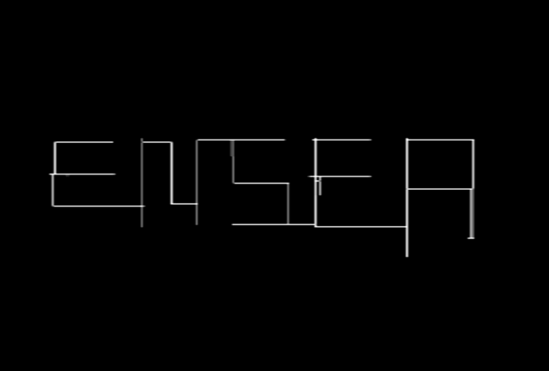
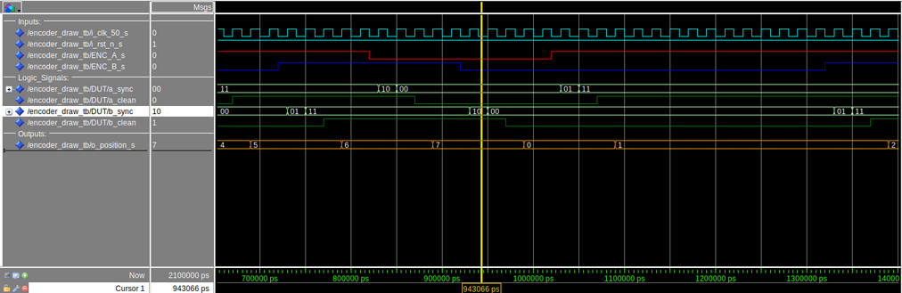
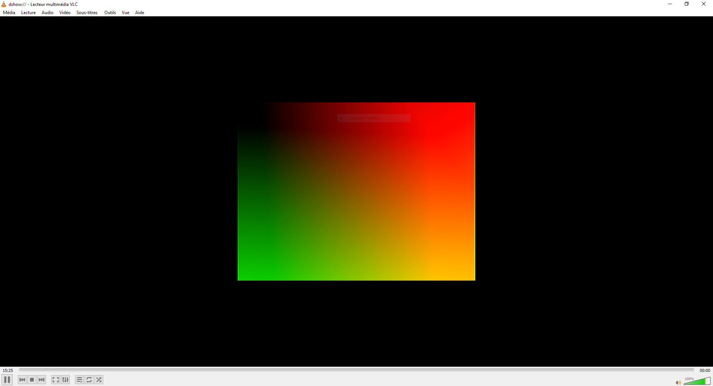

# Télécran FPGA

Un écran magique numérique réalisé en VHDL sur une carte **DE10-Nano**. Deux encodeurs rotatifs déplacent le point de dessin suivant les axes horizontal et vertical. Le tracé reste affiché sur un écran HDMI. Un appui sur le bouton de l’encodeur gauche efface l’image et permet de reprendre le dessin à la même position.

**TP FPGA S7 à l’ENSEA** · Redwon Mohammad et Yehia Zeaiter

## Gestion des encodeurs rotatifs

Chaque encodeur fournit deux signaux en quadrature, A et B. À 50 MHz, le circuit conserve les deux derniers échantillons de chaque voie. Deux échantillons hauts font passer la sortie filtrée à 1, deux échantillons bas la font passer à 0, et des échantillons différents conservent l’état précédent.

Le décodeur compare ensuite l’état courant de la paire A/B à l’état précédent pour déterminer le sens de rotation. Le compteur avance ou recule d’un pixel à chaque transition valide. Il reboucle aux limites de l’image, de 0 à 719 sur l’axe horizontal et de 0 à 479 sur l’axe vertical.

La simulation du TP montre que `b_clean` conserve sa valeur lorsque `b_sync` vaut `10`, puis passe à 0 après stabilisation à `00`. Avec une limite de comptage fixée à 7 pour cet essai, on observe aussi le retour à 0. Sur la carte, un test avec une rangée de LED a permis de vérifier la réponse du compteur à la rotation.

## Déplacement d’un pixel sur la sortie HDMI

Le contrôleur HDMI du TD fournit les coordonnées du pixel en cours de balayage. Un premier essai, visualisé dans VLC, a affiché un dégradé avec une composante rouge variant horizontalement, une composante verte variant verticalement et une composante bleue nulle. L’étape suivante a affiché un pixel rouge brique sur fond blanc lorsque les coordonnées du balayage coïncidaient avec celles des encodeurs.

## Mémorisation, dessin et effacement

Une mémoire double port stocke l’image de **720 × 480 pixels**, à raison de 8 bits par pixel. L’adresse linéaire d’un pixel de coordonnées `(x, y)` est `x + y × 720`.

| Port | Horloge | Rôle |
| --- | --- | --- |
| A | 27 MHz | Lit le pixel demandé par le balayage HDMI. Sa valeur alimente les trois composantes couleur. |
| B | 50 MHz | Écrit `0xFF` à la position des encodeurs pour tracer en blanc. |

L’effacement prend la priorité sur le dessin. Lorsque le bouton gauche est pressé, un compteur balaie les adresses de la mémoire et écrit `0x00` à chaque emplacement pour rétablir le fond noir. Une fois le balayage terminé, le port B reprend l’écriture à la position courante des encodeurs. Le compte rendu présente un exemple de tracé obtenu pendant le TP.

## Sources et état de la compilation

- [`telecran.vhd`](telecran.vhd) relie les encodeurs, la mémoire et la sortie HDMI.
- [`encoder_control.vhd`](encoder/encoder_control.vhd) filtre et décode les signaux des encodeurs.
- [`dpram.vhd`](dpram.vhd) implémente la mémoire double port.

Pour reconstruire le projet complet avec **Quartus Prime Lite 24.1**, il faut aussi récupérer le contrôleur HDMI du TD, le projet Quartus et ses contraintes pour la DE10-Nano, l’initialisation HDMI par I²C de Terasic et les IP PLL d’Intel pour le Cyclone V `5CSEBA6U23I7`.

Lors d’une compilation récente du projet local complet, la synthèse s’est arrêtée car [deux affectations concurrentes pilotent `o_hdmi_tx_d`](telecran.vhd#L247-L251). L’une affiche le contenu de la mémoire et l’autre correspond à l’essai du pixel rouge. Une nouvelle compilation pour la version avec mémoire nécessite un seul pilote pour cette sortie.
